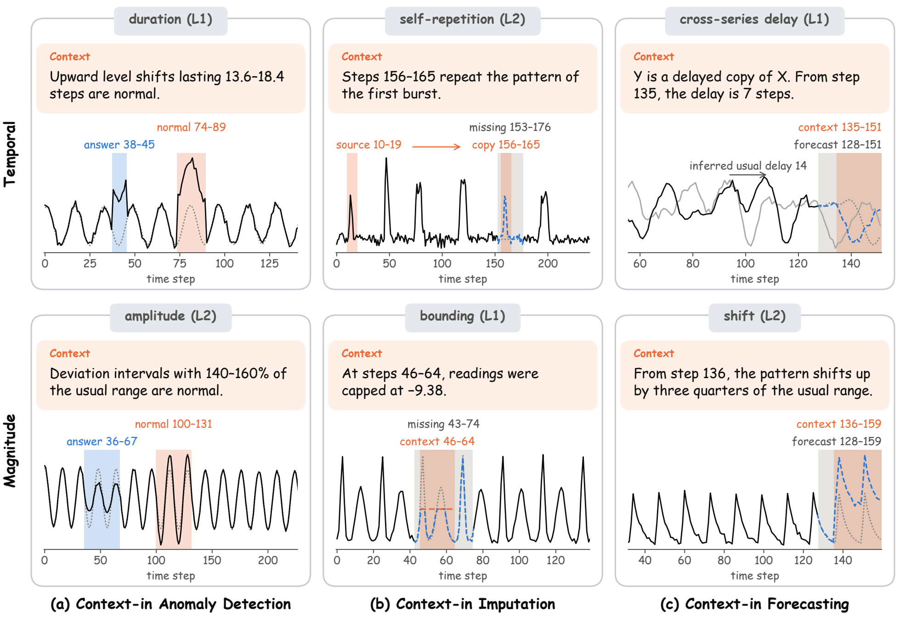

# CiT-Bench

CiT-Bench evaluates the use of textual context in time-series anomaly detection (AD), imputation (IMP), and forecasting (FC). This repository contains the benchmark queries, labels, evaluation protocol, and scoring code. The dataset contains **1,200 queries** in total.



*Examples from the released AD v15.1 and IMP/FC t3 data. Blue marks the target interval or hidden ground truth; orange marks the deviation declared normal in AD or the event specified by context in IMP/FC. Ground-truth annotations and hidden values are shown only to explain the benchmark; they are not part of model inputs. [Download the vector PDF](assets/fig_benchmark_dataset.pdf).*

| Task | Scenes | Queries per scene | Queries | Level 1 magnitude | Level 1 temporal | Level 2 magnitude | Level 2 temporal |
| --- | ---: | --- | ---: | ---: | ---: | ---: | ---: |
| Anomaly detection | 100 | Level 1/2 × context A/B | 400 | 100 | 100 | 100 | 100 |
| Imputation | 200 | Level 1/2 | 400 | 100 | 100 | 100 | 100 |
| Forecasting | 200 | Level 1/2 | 400 | 100 | 100 | 100 | 100 |

Level 1 states the relevant attribute in absolute terms. Level 2 expresses the same attribute relative to a reference inferred from observations. AD has two queries per scene and level: A and B share the observations, but the context declares opposite candidate deviations normal. IMP and FC have one query per scene and level; the two levels share observations and target values. The dataset has no null queries.

## Contents

Each task directory has `prompts.jsonl` (the exact model messages and sampling settings), `records.jsonl` (labels and scoring data), and `tags.jsonl` (analysis metadata). `AD/pairs.jsonl` identifies A/B query pairs. `IMP/scenes.jsonl` and `FC/scenes.jsonl` identify the two levels of each scene.

The root contains `protocol.json`, `cit_eval.py` (parsing, retries, and metrics), `evaluate.py` (scoring saved responses), `run_vllm.py` (optional text-model runner), `verify.py`, `self_test.py`, and a checksum manifest. `generator/` contains the IMP and FC generation pipeline and supporting modules. A complete one-command AD regeneration script is not part of this release.

**Use `prompts.jsonl` as model input.** Do not construct a prompt from `records.jsonl`: records contain the answers. In particular, the legacy `context` field in `AD/records.jsonl` does not contain the normal-exclusion wording used by the evaluated prompts. The released `AD/prompts.jsonl` is authoritative.

## Install and verify

Python 3 and NumPy are required for scoring and verification. The vLLM runner requires a separate compatible vLLM installation.

```bash
python3 -m pip install -r requirements.txt
python3 verify.py
python3 self_test.py
sha256sum -c SHA256SUMS
```

`verify.py` checks the file manifest and the matching prompt/record IDs. `self_test.py` checks parsing, retries, seeds, and scores without running a model.

## Run and score

The runner accepts `ad`, `imp`, and `fc`. It writes ordered raw samples for each query and resumes an incomplete output file.

```bash
python3 run_vllm.py --model /path/to/model --task ad --out runs/MODEL/ad.jsonl
python3 run_vllm.py --model /path/to/model --task imp --out runs/MODEL/imp.jsonl
python3 run_vllm.py --model /path/to/model --task fc --out runs/MODEL/fc.jsonl
python3 evaluate.py --task ad --responses runs/MODEL/ad.jsonl --out runs/MODEL/ad_score.json
python3 evaluate.py --task imp --responses runs/MODEL/imp.jsonl --out runs/MODEL/imp_score.json
python3 evaluate.py --task fc --responses runs/MODEL/fc.jsonl --out runs/MODEL/fc_score.json
```

If you use another inference system, preserve the messages and sampling settings in `prompts.jsonl`. The scorer expects JSONL rows of the form `{"id": "...", "samples": ["first raw response", "second raw response"]}`; the `samples` array must retain generation order. `evaluate.py` treats missing queries as failures.

All tasks use temperature 1, top-p 1, no top-k cutoff, a 2,048-token output limit, and answer-only prompts. AD accepts the first valid integer `start`/`end` interval from at most five draws. A response is correct at intersection-over-union (IoU) ≥ 0.5. Accuracy counts correct queries; pair consistency counts A/B pairs for which both queries are correct.

IMP and FC require 25 valid trajectories. The protocol draws 25 responses, then up to three rounds of five after invalid responses, for at most 40 draws. A query without 25 valid trajectories receives RCRPS 1. Coverage is the fraction of queries with 25 valid trajectories. RCRPS is the range-normalized fair CRPS with equal weights for steps inside and outside the region of interest. Exact parsing and retry rules are in `cit_eval.py` and `protocol.json`.

## Reproducibility notes

The data files in this repository are byte-identical to the AD v15.1 and IMP/FC t3 source data recorded in `MANIFEST.json`; the public README and manifest are release-specific. `reference_results.json` and draft paper figures from the older internal bundle are omitted because they do not represent the complete final evaluation. Model responses and weights are not included. The dataset and scorer can be used without GPU hardware.

## License and attribution

Copyright (c) 2026 Jaeseong Kim. The benchmark data are released under CC BY 4.0 and the evaluation and generation code under MIT; see [LICENSE.md](LICENSE.md) for the exact file scope and full license texts. The public release URL is <https://github.com/Jay-Kim26/CiT-Bench>. Cite CiT-Bench and link to this repository when using the data. A paper citation will be added when the final bibliographic details are available.
